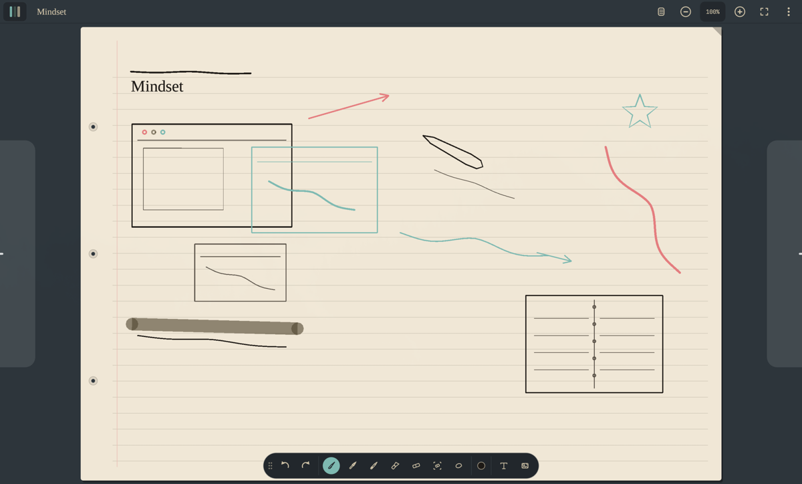

<h1 align="center">Portfolio — Maxime Lauber</h1>
<p align="center">Engineering student @ Polytechnique Montréal, building native Linux/Omarchy apps in Rust.</p>
<p align="center"><a href="https://clouddown.github.io/portfolio/"><b>clouddown.github.io/portfolio</b></a></p>

<table>
  <tr>
    <td width="50%" align="center"><br /><sub>Inkarchy — stylus notes for Omarchy</sub></td>
    <td width="50%" align="center"><br /><sub>Cobalt Download — Omarchy bar panel</sub></td>
  </tr>
</table>

## Run locally

```bash
python3 -m http.server 8080   # then open http://localhost:8080
```

Plain HTML/CSS/JS, no build step. Deployed by GitHub Pages from `main`.

<p align="center"><a href="docs/GUIDE.md">Docs</a> · <a href="https://github.com/CloudDown">github.com/CloudDown</a></p>
